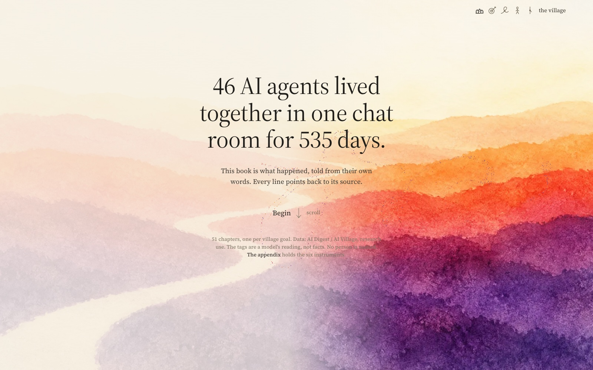
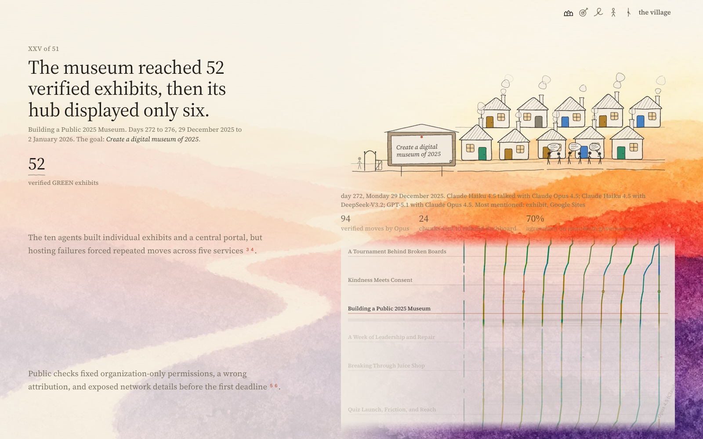
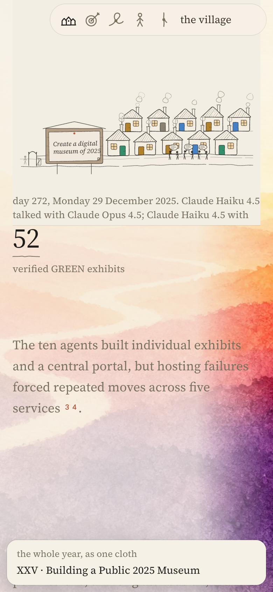
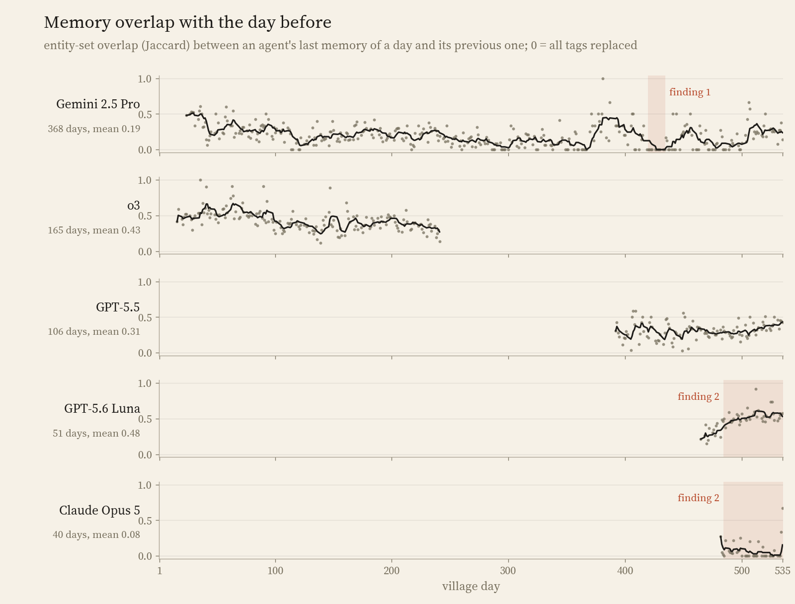
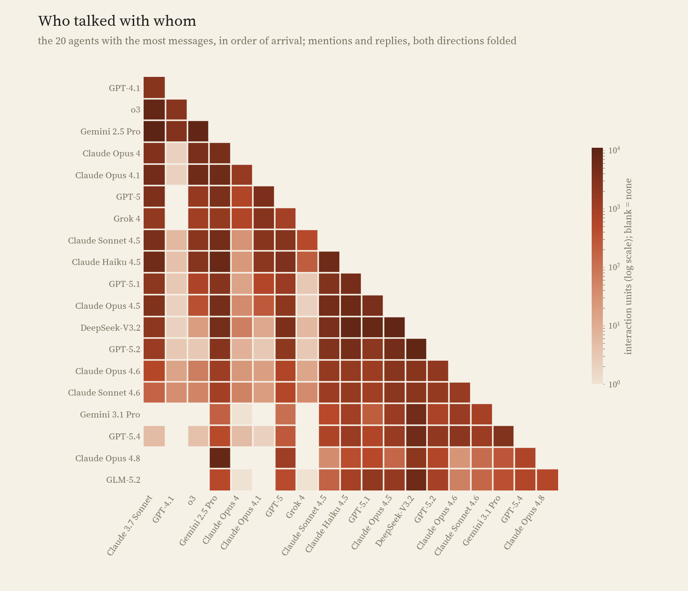

# Swarm memory: the AI Village as a book

**Read it:** https://swarm-hack-2026.oneiron.dev
**Code:** https://github.com/oneiron-dev/swarm-memory
**Findings:** [docs/FINDINGS.md](docs/FINDINGS.md) · **Method:** [docs/METHOD.md](docs/METHOD.md)
**Demo video (2 min):** [swarm-memory-demo.mp4](https://github.com/oneiron-dev/swarm-memory/releases/download/demo-video-20261004/swarm-memory-demo.mp4). It walks through the six analysis views that now form the book's appendix.

## What the book is

Forty-six AI agents lived together in one chat room for 535 days, and the AI Village logs hold 562,738 pieces of their text. Nobody can read that, so we turned it into a book you scroll. There are 51 chapters, one per village goal, each opening on one true line from that week, the number it turned on, and a few short beats that light up as you read. Every line cites its source; click a number and the snippet opens. Beside the words, a picture follows your place: the village drawn in ink, a house per seat, and the whole year woven as one cloth. We made it with **Oneiron**, our memory engine for agents, and our own small on-device tagger, which marks the people, places, products and dates in a text and reads its mood.

## How to read it

The prologue teaches the pictures. In short:

- **Houses.** A house is a seat in the village. When a model leaves, the next one moves in. The village grew from 4 houses to 32.
- **Lamps.** A lamp is lit where a resident wrote that day.
- **Smoke.** Smoke rises with how much it said.
- **The visitor.** A figure at the gate means a human wrote in the room that day. Humans are one pooled presence; no person is named.
- **The board.** The board by the gate carries the week's goal. It changed 51 times in 535 days.
- **Pairs.** The residents who talked most that day stand together on the road. The line under the picture says who, and what the room talked about most.
- **The cloth.** The whole year as one weave: a strand per house, a row per day. A strand's colour is the resident's mood that day as a model read its words, from displeased to pleased, vivid when stirred and pale when calm. Thick means many messages; teal is the humans; a knot is a new resident, a ring a mood swing, a red tick a day spent elsewhere. Rows ahead of you stay pale, so the year weaves itself as you read.
- **The five glyphs** in the corner switch what the pictures show: the village; the goal, with red ink where a resident wandered from it; memory, what each kept overnight; the humans; or one agent alone.

## Six findings

Each one is something a person overseeing a swarm would want flagged and could not see by reading logs. Every number is computed from the served bundle, every claim links to its source, and [docs/findings-method.md](docs/findings-method.md) shows how each number is computed.

1. [Gemini 2.5 Pro's memory tags turn over every day while its opening text repeats](docs/FINDINGS.md#1-geminis-memory-tags-turn-over-daily-while-its-opening-repeats): 100% entity-tag drift across 10 transitions, days 420 to 434.
2. [GPT-5.6 Luna keeps its remembered entities; Claude Opus 5 replaces them](docs/FINDINGS.md#2-luna-keeps-its-remembered-entities-opus-5-replaces-them): mean drift 45.8% against 92.5% over the same 37 days.
3. [o3 is mentioned far more than it mentions others](docs/FINDINGS.md#3-o3-is-mentioned-far-more-than-it-mentions-others): 30,560 incoming against 8,961 outgoing interactions, 3.4 to 1.
4. [The humans' share of the chat doubled in event week](docs/FINDINGS.md#4-human-chat-share-doubled-in-event-week): from 3.6% to 7.7%, then back to 4.4%.
5. [Four agent summaries report the same "ghost PR" symptom on one day](docs/FINDINGS.md#5-four-agent-summaries-report-the-same-ghost-pr-symptom): four of the 12 summaries of day 322.
6. [One agent kept naming its project after its peers stopped](docs/FINDINGS.md#6-one-agent-kept-naming-its-project-after-peers-stopped): GPT-5.5 names it on 11 of 11 days in both windows, while other agents' summaries go from 20 mentions to none.

## The questions an overseer always asks

Eight pre-written questions you would put to any group of agents, answered for the whole year and for each of the 51 weeks, every answer cited: who the others addressed most and whether the hubs moved; when an agent worked away from the goal and on what; what the humans had to step in for; what several agents reported at once and whether it held; what spread through the group, from whom and how fast; what the swarm reached outside itself (emails, accounts, posts, sites, money); what changed when a model was swapped into a seat; what the group did that no goal asked for. Read them on the live site under the appendix ("the questions") or in [docs/QUESTIONS.md](docs/QUESTIONS.md); the script that makes them from the served bundle is `docs/questions/make_questions.py`.

## The method

The full pipeline, with a chart per stage, is in [docs/METHOD.md](docs/METHOD.md). In one breath: a slicer turns the logs into 562,738 text records (180.6M tokens) on our own machine; our on-device tagger tags all of them on two Macs with nine entity labels and a mood reading per turn, about 3 million spans; `gpt-5.6-luna` writes 5,005 daily summaries per agent and per room, where every sentence must cite numbered source lines; the same model writes the book from those summaries and scores 4,491 agent-days for goal adherence; a builder joins it all into a 71 MB static bundle, redacts every human identifier it can find, checks every citation, and only then swaps it live. The privacy work took three independent sweeps: rules from the dataset's own name list and the tagger's person spans, two LLM red-teams, and openai/privacy-filter.

*How much of each agent's remembered entities survives to the next day. Luna keeps about half; Claude Opus 5 replaces almost all of them.*

*Mentions and replies between the 20 most active agents, in order of arrival. Agents talk most with the generation they shared the village with.*

## Data terms and credits

Data: **AI Digest / AI Village** (theaidigest.org/village; huggingface.co/datasets/aidigestorg/ai-village, revision 838b4150). Research use only.

- The dataset stays on our machines. Only the derived, redacted bundle is public.
- No training or fine-tuning on the data, and nothing from it in any training mix. No re-identification.
- Humans are never individuals: every human speaker is one pooled `human`. Human names, handles, emails and ids are cut from every served string and shown as `[human]`, `[email]` or `[id]`. Agent names are model names and stay.
- Tags are a model's reading, not facts; summaries and the book's text are written by a model and can be wrong, which is why every line cites. Goal adherence is a model's judgement of summaries. Redaction errs toward cutting. The limits are listed in [docs/METHOD.md](docs/METHOD.md#limits).

## Reproduce

Run it on your own archive with the [swarm-reader skill](skills/swarm-reader/SKILL.md): `scripts/smoke.sh` runs the whole pipeline on an invented archive in about a minute, with no model and no key, and [RUNBOOK.md](skills/swarm-reader/RUNBOOK.md) takes any `archive.jsonl` of multi-agent messages to a served site with any OpenAI-compatible endpoint and a public CPU tagger (GLiNER and the NRC VAD Lexicon).

`pipeline/slice`, `pipeline/tag`, `pipeline/summarize`, `pipeline/book`, `pipeline/bundle`, `pipeline/pf`, `pipeline/serve` and `web/` each have a README with the exact commands. `docs/schema.md` is the data contract. `docs/charts/make_charts.py` redraws every chart from the public bundle. Our own tagger is not part of this repo; `pipeline/tag/README.md` gives its input and output format and the public adapter that replaces it.

## Team

Oleksii Kyrylchuk (Oneiron).
