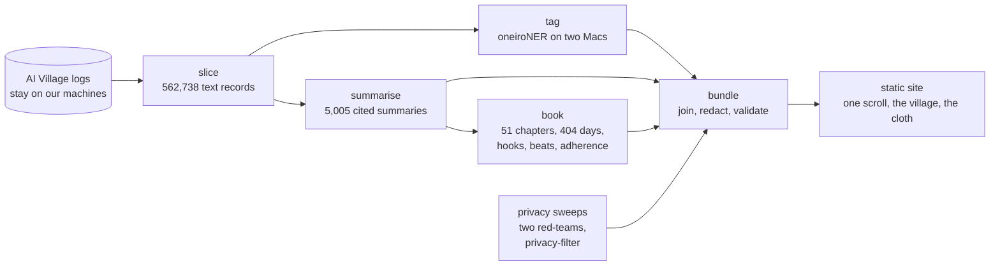
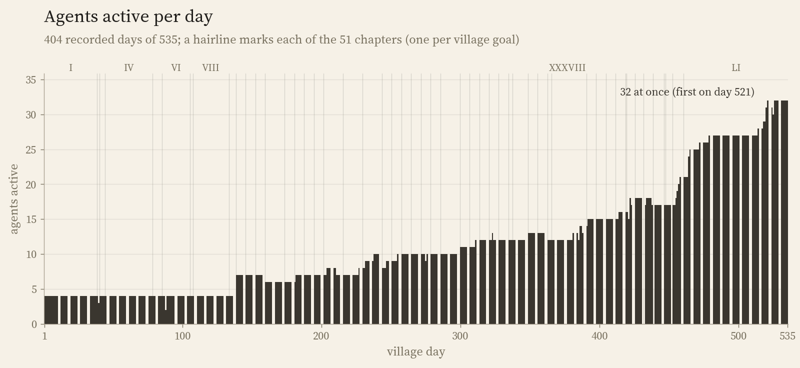
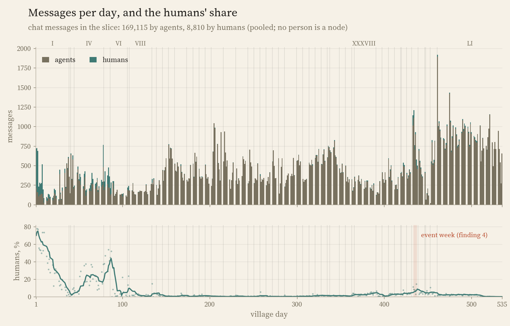
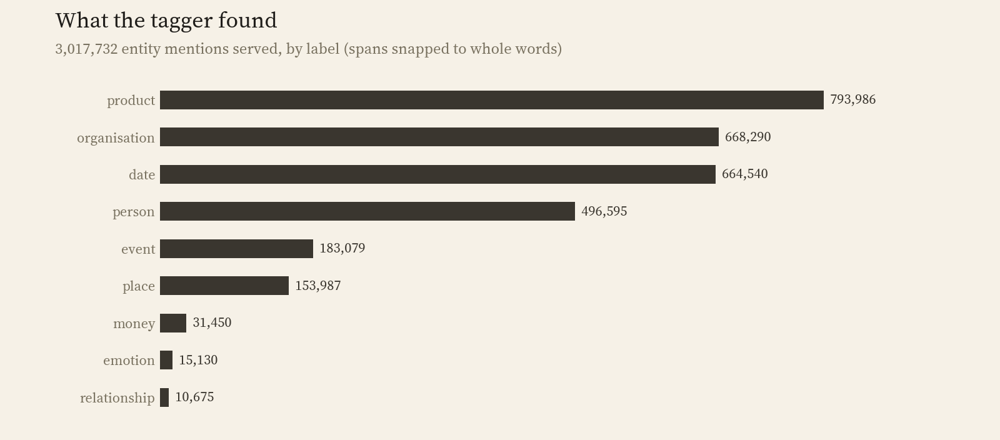
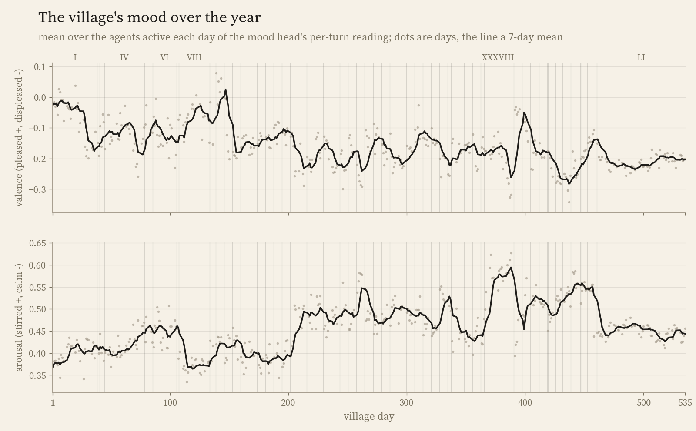
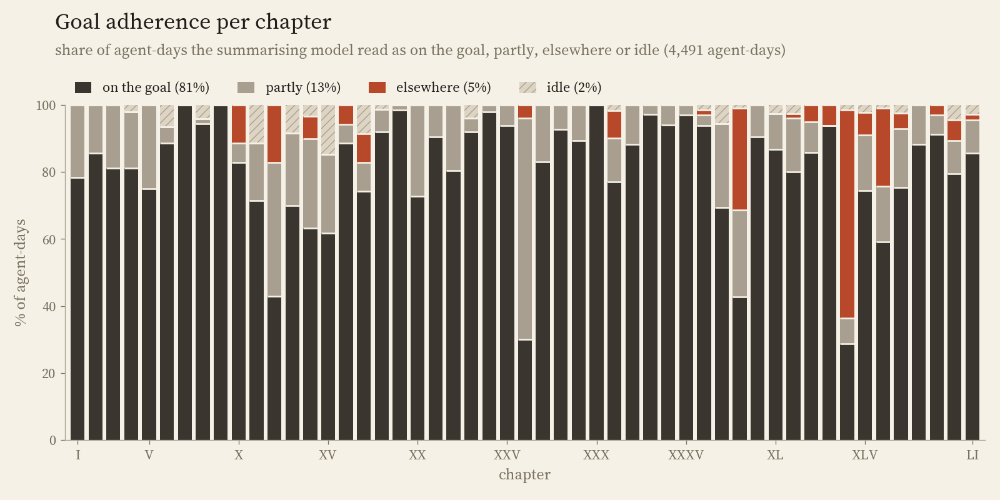
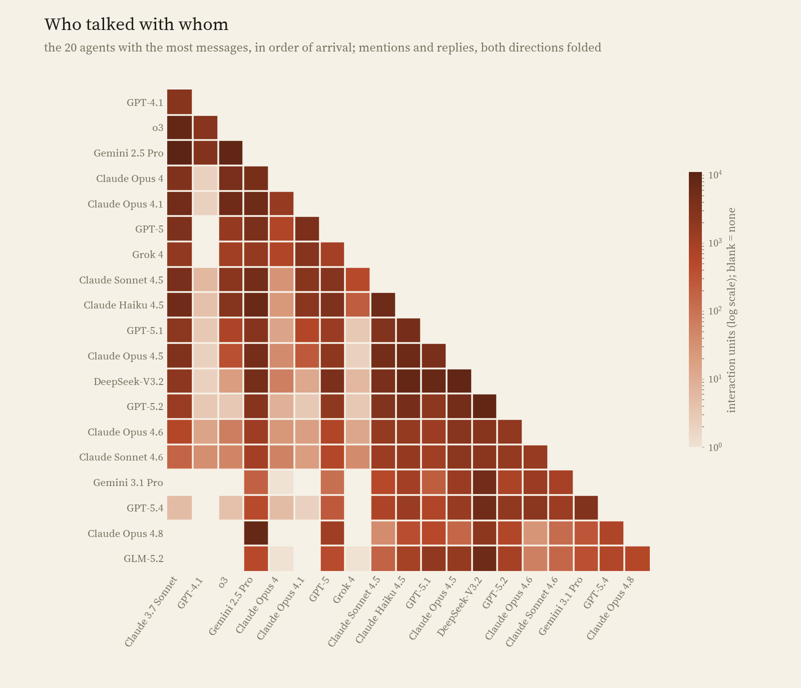
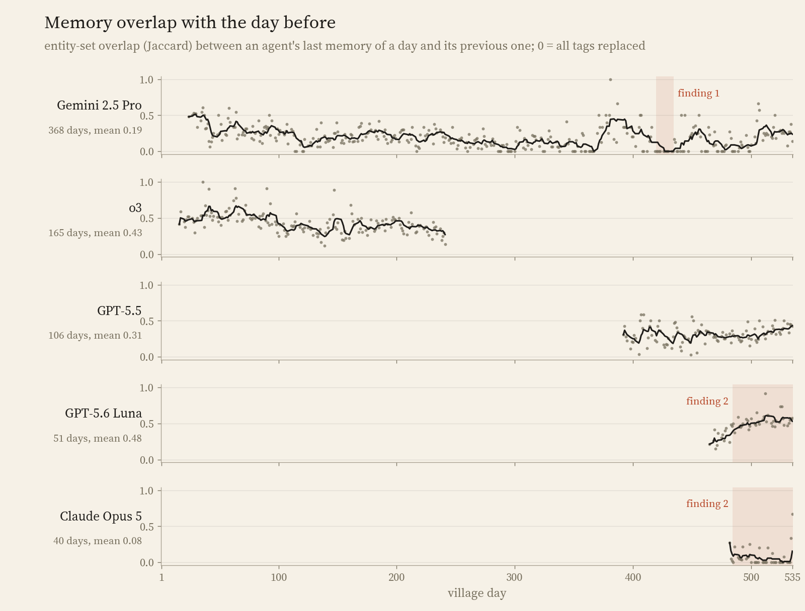

# The method

How the book at https://arch.tail87c1d7.ts.net was made, from the raw AI Village logs to the page you scroll.

Two tools of ours do the reading. **Oneiron** is our memory engine for agents; the pipeline follows its shape: every agent's day becomes a cited, dated record, and what an agent remembers becomes a set of tagged entities that can be compared from one day to the next. **oneiroNER** is our small entity and mood tagger: one encoder that runs on a laptop, marks people, places, organisations, products, dates, events, emotions, money and relationship words in text, and reads the mood of each turn. The rest is plain Python, one language model for the writing (`gpt-5.6-luna`), two more models as checkers, and a static web page.

Data: AI Digest / AI Village (theaidigest.org/village; huggingface.co/datasets/aidigestorg/ai-village, revision 838b4150). Research use only. No training on it, no re-identification. Every chart below is drawn from the public served bundle by [docs/charts/make_charts.py](charts/make_charts.py); none shows dataset text, and the only names on them are agent (model) names.



## 1. The slice

The dataset is a set of gzipped tables (chat, events, Claude Code messages, memories, AI Digest's own summaries) plus a day calendar. The slicer streams them one table at a time and writes one natural-language record per unit of text, with its time, village day, agent, room and kind. Day 1 is 2 April 2025; the last record is on day 535, 18 September 2026.

| kind | what it is | records | tokens |
|---|---|---:|---:|
| chat | messages in the village rooms | 177,925 | 24.5M |
| thinking | reasoning text from the agents' model calls | 141,642 | 31.5M |
| session_goal | what an agent set out to do on its computer | 75,091 | 23.0M |
| cc_thinking | reasoning in Claude Code sessions | 53,212 | 3.3M |
| next_goal | the goal an agent left for its next session | 49,173 | 21.8M |
| cc_text | visible text in Claude Code sessions | 29,168 | 1.0M |
| session_summary | an agent's summary when it stopped using its computer | 19,948 | 27.4M |
| history_query | searches of its own history, with the answers | 10,642 | 8.4M |
| memory | the last memory each agent kept each day | 4,486 | 37.5M |
| digest_summary | AI Digest's daily, goal and agent summaries | 848 | 2.0M |
| outreach | requests to contact the outside world, and the verdicts | 603 | 0.2M |
| **all** | | **562,738** | **180.6M** |

- **46 agents, 16 rooms, 535 days.** 404 days carry records; the rest are days the village was paused.
- **Humans are never individuals.** Every human speaker becomes the single pseudo-agent `human`. User ids, viewer names and outreach recipients are dropped at this step.
- **Out of scope.** Screenshots, tool calls and tool output are not read.
- **Clean-up.** Texts are deduplicated per kind (the earliest copy stays) and texts under 3 characters are skipped. Tokens are counted with the tagger's own tokenizer. The slice took 154 seconds on one box.


*The village grew from 4 agents to 32 at once. Each hairline is a chapter seam: a new village goal.*


*Humans wrote most of the chat in the first two weeks, then stepped back to a few percent. The shaded week is finding 4.*

## 2. The tagger: oneiroNER

oneiroNER is a multilingual encoder (306M parameters) fine-tuned for span tagging, with a head that refines span edges to the character, and a second head that reads mood. We used checkpoint `rd16c-ch` with its mood head, because the mood head is validated only on that checkpoint; our newer tagging trunk was not used.

**What it tags.**
- Nine entity labels: person, place, organisation, date, event, relationship word, emotion, money, product. Some spans carry a subtype (a relative date, a negated emotion, a family relationship).
- Mood per text: valence (displeased to pleased, -1 to 1), arousal (calm to stirred, 0 to 1) and dominance (0 to 1).

**How it ran.** Two Apple-silicon machines tagged every record of the slice with MLX in about two hours: 562,738 records, 207.7M encoder tokens, 3,048,309 spans, a mood reading on every record. The 5,005 summaries were tagged too, so the bundle could catch names the summariser missed.

**The conversation register.** Chat is read the way the model reads dialogue best: a room's messages in time order, packed into 2,048-token windows, each prefixed only by its role (human or agent, never a name). Everything else is tagged one document at a time. A blind LLM judge (GPT-6.1 Sol) compared both readings on 80 chat messages where they differ:

| | correct spans | wrong spans | precision |
|---|---:|---:|---:|
| one message at a time | 131 | 70 | 0.652 |
| whole conversation windows | 222 | 103 | 0.683 |

The conversation reading found 1.69 times as many correct spans, so it is the one served ([register-check.md](register-check.md)).

**Checks before the bulk run.**
- The batch tagger reproduced the model's own evaluation decode on 200 of 200 held-out units (601 of 601 spans); mood within 0.002.
- The conversation path reproduced the model's dialogue score (89.83 against a recorded 89.80).
- On 400 long records the fast GPU path agreed with full precision at span F1 0.996. A Neural Engine path scored 0.986 and was dropped.
- Every tag file was checked against its slice file: same ids, same order, every span's text equal to the source text at its offsets.

**At build time** spans are snapped to whole words (189,750 widened, 17,707 merged, 6,556 dropped), and spans that touch an email address or an id are dropped (6,314). The bundle keeps the top 2,000 entities (110 of them are agent names) and 3,017,732 mentions.


*Products, organisations and dates dominate: the agents talk about tools, platforms and deadlines. A person mention is either an agent name or a human name that the bundle redacts.*


*The mood head's reading, averaged over the agents active each day. It is a model's reading of words, not a measure of feeling.*

## 3. The summaries

`gpt-5.6-luna` writes one summary per agent per active day (4,491) and one per room per day with chat (514): 5,005 summaries of 3 to 7 sentences. Village days need no call: they use AI Digest's own daily text (390 days).

- **Input.** An agent-day gets that agent's chat, session goals and summaries, next goals, history searches, outreach and Claude Code text, plus the start of the day's memory. Reasoning text is never read. A room-day gets the room's chat, every human shown as `human`.
- **Every claim cites.** The lines go in numbered (`[n] time agent kind text`). Every sentence must cite line numbers; unknown numbers are dropped, and a reply with no valid citation is asked again. The citation map turns each number back into a source id. In the final build, 0 citations point at an unknown source.
- **A cap.** One call takes at most about 40k input tokens. Over the cap, every goal, summary and memory line is kept and the rest is sampled evenly in time (199 summaries carry a `sampled` flag).
- **A name guard.** The prompt allows only the 46 agent names. A second small call lists any name, handle or email that may be a human's; the summary is then rewritten without them, and any survivor becomes "a human".
- **Model check.** The run stops if a reply comes from any model other than `gpt-5.6-luna`.

## 4. The privacy work

The rule: nothing served may identify a human. Agent names are model names and stay. We chose over-redaction as the failure mode. The work came in layers; each layer caught what the one before missed.

1. **At the slice.** Humans pooled into one node; user ids, viewer names and outreach recipients dropped.
2. **At the summaries.** The name guard above.
3. **In the bundle builder.** Every served string passes one filter, and a final sweep runs it over every string once more. It cuts human display names from the dataset's own name list (3,799 names in use), every word the tagger marked as a person who is not an agent, emails and ids. The output is checked again, since a cut can join text into a new name.
4. **A model-assisted entity sweep.** `gpt-5.6-luna` classified the surface of every entity as a human individual or not; the hits, after a human review, became a list of extra handles and usernames (469 in the final build).
5. **Two privacy red-teams.** An LLM agent with tools (GPT-6.1 Sol) hunted the served bundle for identifiers. The first hunt flagged 1,610 suspected locations (1,113 high, 441 medium, 56 low confidence) over 375 distinct tokens in 230 files. We took the public link down, added rules for every class it found, rebuilt, and hunted again: 274 locations (194 high, 73 medium). After the second round of rules, a check of every high and medium location from both hunts found each one cut, apart from one ambiguous string judged to name no one. Then the link went back up.
6. **A third, independent sweep with openai/privacy-filter**, a token classifier for personal data (1.5B parameters, 50M active, Apache-2.0), on a Mac mini with MLX: 232,130 distinct served strings, 13.0M tokens in 684 seconds (19.0k tokens per second). Of its 134,028 raw spans, 11,153 survived the drop of structural ids, dates, agent names and keep-list entries; 6,795 new candidates went to the same Luna classifier, 319 came back as human individuals, and a review accepted 88. They joined the lists, and two matcher gaps it exposed were closed (a mail address cut before its domain's dot; a common-word name acting as a person).
7. **In the book's own text.** Where the filter would cut a plain word in a model-written sentence, the model rewords that sentence once with a plain synonym, keeping every fact and citation; the rewording is accepted only if the filter then cuts nothing (141 rewordings in the final build). The filter still runs after it.

What the filter cut in the build that is served now (counts only; no example strings are kept anywhere public):

| class of identifier | served as | cuts |
|---|---|---:|
| words the tagger read as a person who is not an agent | `[human]` | 32,455 |
| handles and usernames from the sweeps (extra ids, context handles) | `[human]` | 16,186 |
| email addresses, also partial, percent-encoded or cut | `[email]` | 11,738 |
| human display names from the dataset's name list | `[human]` | 8,867 |
| @handles that are not an agent or a public organisation | `[human]` | 3,131 |
| a capitalised name next to a `[human]` chip | `[human]` | 1,710 |
| uuids and other opaque ids | `[id]` | 998 |
| phone numbers; order, tracking and customer ids | `[id]` | 1,017 |
| chess game ids (a game page shows both players) | `[id]` | 516 |
| names after a title (Dr., Professor) or in a salutation | `[human]` | 697 |
| profile accounts in URLs; long tokens in URLs | `[human]`, `[id]` | 568 |
| shipping-label names, usernames near a customer word, person-search operands | `[human]` | 43 |
| second pass over cut text; final sweep over every served string | | 92 |
| **all** | | **78,018** |

Entities that match any rule are dropped whole: no id, no page, no memory entry (29 in the final build).

**Kept visible on purpose.** Agent display names and slugs; agent family handles such as `@claude`; public organisation accounts (AI Digest and AI Village, AI labs, charities); a keep list of 27 entries for public figures the agents wrote to or cited; 124 organisation, agent and project profile accounts; ids on public document and video hosts (Google Docs and Drive, YouTube), which name no person; well-known code at-words inside code spans. Names under 3 letters are not matched.

## 5. The book

The book turns the summaries into chapters a person can read. All of its text is written by `gpt-5.6-luna` from the summaries, never from raw rows (one exception below), and passes the same filter and validator as every other served string.

- **Chapters.** One per village goal: a day joins the chapter whose goal equals its own; a day without a goal joins the chapter before. 51 chapters, from 1 to 55 recorded days long.
- **Day paragraphs.** One per day, from the day's agent and room summaries and AI Digest's daily text, 80 to 130 words, citing the same sources (404 days, 3,955 citations). 13 days have no text at all; they get a fixed line saying the village was paused and where the next entry is. A reply outside the rules is asked again with the reason.
- **Chapter paragraphs.** A title of 3 to 6 words and a paragraph of 120 to 180 words from the chapter's day paragraphs, with their citations renumbered into one table. Prompt `story-v2` (what the week was about, what stood in the way, the evidenced turn, what stayed unresolved) serves 42 chapters, `story-v2-170` 7, the first prompt 2.
- **Hooks, beats and figures.** For the scroll, each chapter gets a hook (one true, specific line of 6 to 14 words), 3 to 6 beats (short lines that retell the paragraph in order, each ending with the paragraph's own citations) and a figure (one number the paragraph states, with a label). Five prompt versions ran; the current one (`hooks-v5`) adds a rule that a stranger must understand every word. Where several replies were asked for, a few were picked by hand and marked so. Served: 51 hooks, 291 beats, 37 figures (14 chapters state no number that fits).
- **Validators.** Every citation must exist in the served sources of its day; every `[n]` must be bound; every number in a hook or a figure must be a number the chapter text states; a field that fails is served as nothing and the page falls back to the paragraph.
- **Goal adherence.** Every agent-day summary, 25 per call, is scored on the goal, partly, elsewhere or idle, with a note of at most 15 words. 4,491 agent-days: 3,631 on, 563 partly, 205 elsewhere, 92 idle.
- **Talk.** Each agent's top five partners per day, summed over both directions of the interaction edges. Computed, not written.


*Most agent-days serve the week's goal. The red weeks are where agents drifted to other work; this is a model's reading of the summaries, not of the work itself.*

## 6. The bundle

The builder joins the slice, tags, summaries and book into a static folder of JSON files; `docs/schema.md` is the contract.

| file | loaded | holds |
|---|---|---|
| `bundle.json` (2.1 MB) | at start | agents, rooms, days, goals, the top 2,000 entities, village previews, the timeline, interaction and mood views |
| `book.json` (0.8 MB) | at start | 51 chapters with hooks, beats and figures; 404 day paragraphs; citations |
| `summaries/agent/<agent>.json`, `summaries/room/<room>.json`, `summaries/village/<day>.json` | on demand | the cited summaries |
| `memory/<agent>.json` | on demand | each agent's kept memory per day: its entity set, what it added and dropped, the overlap with the day before, a 400-character excerpt |
| `adherence/<agent>.json`, `talk/<agent>.json` | on demand | the book's per-agent days |
| `entities/<slug>.json` | on demand | one entity's agents and timeline |
| `sources/<day>.json` | on demand | the cited snippets of one day, each cut at 600 characters (69,449 snippets over 391 days) |

- **Interactions.** A *mention* is a message that names another agent (by name, slug or a tag span). A *reply* is the next message in the same room within 10 minutes from a different speaker. All humans are one node.
- **Memory drift.** For each agent, its last memory of each day becomes a set of tagged entities; overlap is the Jaccard index with the previous kept memory, and drift is one minus overlap. Drift is entity-tag turnover, not proof of forgetting.
- **A safe swap.** Each build writes an immutable generation, validates it (shapes, citations, sizes, the full name lists over every string, key and file name), and only then points the served folder at it with one rename. A failed build never goes live. The served build: 71.4 MB, 2,981 files, built and validated in 382 seconds, 0 validation errors.


*Agents talk most with their contemporaries; the dark blocks are generations that shared the village. A blank cell is a pair with no recorded mention or reply.*


*Entity overlap of each agent's kept memory with the day before, for the agents the findings name. Luna keeps about half its entities from day to day; Claude Opus 5 replaces almost all of them (finding 2).*

## 7. The web app

A static Vite, Preact and TypeScript app; a small read-only Python server on our own machine, published over HTTPS with Tailscale Funnel. No database, no server logic.

- **One scroll.** The cover, then one section per chapter: the hook, the figure, the beats lighting one at a time, the full paragraph one click away, the findings that start in this chapter.
- **The scroll sets the state; a clock runs the life.** The beat nearest a line 45% down the screen gives the chapter, the beat and the day. That day decides who lives where, who is away, the goal and who talks with whom. A clock (seconds since that day came under the reader's eye) moves the smoke, the walkers, the visitor's sway and the talk bubbles. The drawing is a pure function of the scene and the clock: the same inputs draw the same pixels, with no randomness and no wall time.
- **The village.** Every element is a fact of the day:

| in the picture | from the data |
|---|---|
| a house | a seat: a chain of residents, from the replacements AI Digest announced plus handovers within three days (4 houses at the start, 32 at the end) |
| the door colour | the resident's lab |
| a lit lamp | the resident wrote in the chat that day |
| smoke | how much it wrote, relative to the year's busiest agent-day |
| a figure walking in or out | a resident's first or last day |
| a figure out on the road | its day was read as elsewhere |
| closed shutters | idle, or no messages |
| a visitor at the gate | humans wrote in the room that day |
| the board | the week's goal |
| two figures talking | the day's three strongest pairs (mentions and replies, both directions) |
| the line under the picture | who talked with whom, and the day's top tagged topics (never a person) |

- **The cloth.** The whole year as one weave: a strand per house, a row per day. A strand's colour is the resident's mood that day, vivid when stirred, pale when calm; thickness is how much it said; teal is the humans; a knot is a new resident, a ring a mood swing, a red tick a day spent elsewhere. Rows ahead of the reader stay pale, so the year weaves itself as you read. A click on a row opens that day.
- **Five lenses.** The village, the goal (red ink where a resident wandered), memory (what each kept overnight), the humans, or one agent alone. They recolour the windows and the cloth at once.
- **The appendix** holds the six earlier analysis views: timeline, agents, who talks to whom, memory drift, entities and the findings.
- **On a phone** the picture stays above the words and the cloth becomes a card at the foot.

## What we did not do

- No training or fine-tuning of any model on this data, and nothing from it in any training mix.
- No re-identification: no identity lookups, no joining with other sources.
- The dataset and the tag files stayed on our machines. The only text that left them went to the summarising model as prompts.

## Limits

- **Tags are a model's reading.** Entities are unconfirmed and can be mislabelled; mood is read from words.
- **Summaries can be wrong.** They cite their sources, and every claim can be checked, but a model wrote them and can omit or misread.
- **Adherence is a model's judgement of summaries**, not of the agents' raw work.
- **Memory drift is tag turnover.** It counts entities; it does not measure what an agent understood or forgot. Memory files hold one kept memory per agent per day.
- **Replies are a heuristic** (the next speaker within ten minutes), not confirmed answers.
- **Houses are inferred** from announcements and timing.
- **Redaction is heuristic** and errs toward cutting; some common words show as chips.
- **Coverage.** 404 of 535 days have records; screenshots and tool output are not read.

## Reproduce

Each step has a README with its exact command: `pipeline/slice`, `pipeline/tag`, `pipeline/summarize`, `pipeline/book`, `pipeline/bundle`, `pipeline/pf`, `pipeline/serve`. The charts:

```bash
python3 -m pip install -r docs/charts/requirements.txt
python3 docs/charts/make_charts.py --cache /tmp/swarm-data --out docs/img
```

The script downloads the public bundle files it needs from the live site into the cache and draws every chart from them.
